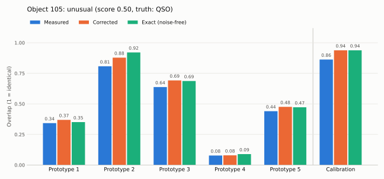
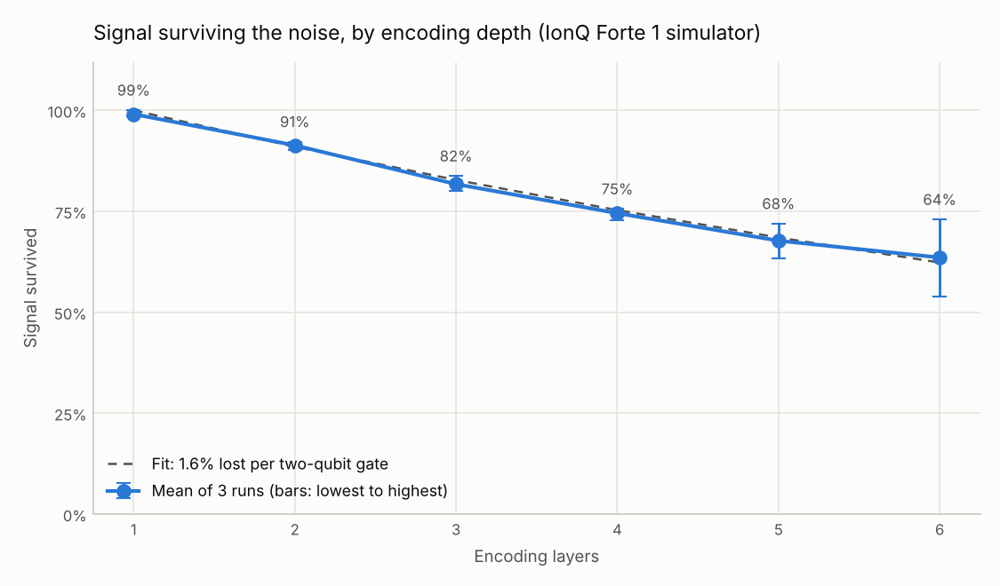
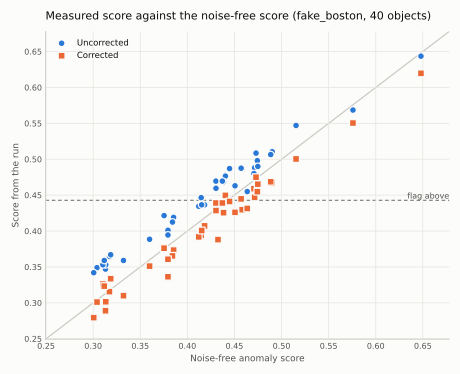

# One Circuit, Self-Calibrated: quantum anomaly scoring for telescope catalogues

**Theme:** Quantum Impact
**Team:** [TEAM NAME] ([NODE])
**Demo video:** [PUBLIC VIDEO LINK]
**Repository:** [PUBLIC REPO LINK]

This effort is supported by Qollab & IonQ.

## What it does

Sky surveys catalogue hundreds of millions of objects. Almost all are ordinary stars and galaxies. Astronomers need software that says "this one is unusual, look at it", without being told in advance what unusual looks like.

This project scores one catalogue object for how unusual it is, using a single 24-qubit circuit on the IonQ simulator. The circuit compares the object against five prototypes of "normal" at the same time, and a sixth block measures the simulator's noise in the same run so the result can be corrected. It then reports an anomaly score, a verdict, and the object's true class so you can check the verdict.

Alongside it is a benchmark of the same idea against four classical anomaly detectors on real survey data. The quantum scorer comes close to the classical methods but does not beat them. What does work is the noise calibration: uncorrected, IonQ-level noise doubles the false-alarm rate, and the calibration block brings it back.

## The results in two tables

280 objects from the Sloan Digital Sky Survey: 120 stars and 120 galaxies as "normal", 40 quasars as the anomalies. Each model learns from normal objects only. The score is ROC AUC (0.5 is chance, 1.0 is perfect), averaged over 10 random train/test splits. Quantum numbers in this table are from noise-free simulation.

| Model | ROC AUC | Spread (std) |
|---|---|---|
| Local outlier factor | 0.804 | 0.024 |
| Classical prototype score, RBF kernel (tuned) | 0.797 | 0.029 |
| One-class SVM, RBF kernel (tuned) | 0.791 | 0.046 |
| Quantum kernel one-class SVM | 0.773 | 0.078 |
| **Quantum prototype score (this project)** | **0.769** | 0.043 |
| Isolation forest | 0.708 | 0.044 |

The quantum scorer is about 0.03 behind the classical method that uses the same five prototypes, which is inside the spread between splits. The classical kernel widths were chosen using the test scores, which favours the classical side. The quantum encoding was fixed in advance.

The effect of noise at the level measured on the IonQ Forte 1 simulator, at 400 shots, with the flagging threshold set without noise:

| Case | ROC AUC | Normal objects flagged | Quasars flagged |
|---|---|---|---|
| No noise | 0.767 | 24% | 65% |
| IonQ-level noise, uncorrected | 0.766 | 53% | 91% |
| IonQ-level noise, with the calibration block | 0.764 | 25% | 64% |

Noise leaves the ranking of objects almost unchanged but pushes every score upwards, so more than half of the normal objects get flagged. The calibration block restores the intended operating point. This table applies the measured IonQ noise level through a simple model. Runs on real simulators are in findings 4 and 6: the correction held on the IonQ simulator, and on an IBM noise-model simulator it helped but overshot.

## How to run it

### On Qollab

1. Open the project and choose **Select QPU**, then an IonQ simulator (tested on Forte 1).
2. Press **Run**. A run takes about 35 seconds at the default 400 shots.
3. Read the console. It prints how much signal survived the noise, the overlap with each prototype (measured, corrected and exact), the anomaly score, the verdict, and the true class, followed by a bar chart of the same numbers.
4. To score a different object, change **Object Number** under Run settings. Objects 0 to 95 are normal and 96 to 135 are quasars.
5. To trade time for precision, change **Shots**. Each shot adds about 45 ms on the IonQ noisy simulator, on top of about 12 seconds of fixed overhead.

6. **Layers** changes the number of encoding layers, for studying noise against circuit depth. Every reported result uses 2, and no verdict is given at other values. **Chart** turns the bar chart off.

An example run, object 105 (a quasar) on the IonQ Forte 1 simulator:



A run needs `main.py`, `quantum_core.py`, `runner.py`, `experiments.py` and `model.json`. It uses Qiskit, NumPy and Matplotlib, which the Qollab runtime already provides, so no `requirements.txt` is needed.

On a backend that is not IonQ, such as Qollab's built-in simulator, the same six blocks are sent as six separate 4-qubit circuits. Local simulators accept many circuits per run, and this avoids simulating 24 qubits in the browser. The numbers mean the same thing, and on a noise-free simulator the calibration block reports 100%.

### Experiments on Qollab

The **Experiment** field under Run settings switches between three modes.

| Experiment | What one run does | Where it runs |
|---|---|---|
| `score` (default) | Scores one object and gives a verdict | Any backend |
| `depth` | Measures how much signal survives the noise at 1 to 6 encoding layers, using six calibration blocks side by side in one circuit | Any backend |
| `sample` | Scores many objects (**Sample Size**, default 40) and compares the verdicts with and without the correction | A browser simulator, for example an IBM noise-model simulator. On IonQ it scores one object per run |

Every experiment run ends with a line starting `RESULT` that holds its numbers as JSON. Paste the console output of one or more runs into a text file and run `python collect_runs.py pasted_output.txt` to get the tables and add the runs to `ionq_runs.json`.

### Reproducing the benchmark locally

The benchmark runs thousands of small circuits, and IonQ backends on Qollab accept one circuit per run, so it runs on a laptop and its results ship as files.

```
pip install -r requirements-dev.txt
python test_core.py                               # 10 checks of the circuit and the correction
python prepare_data.py star_classification.csv    # writes objects.csv
python compare.py                                 # writes model.json and results.json
python noise_check.py                             # optional
python tuning_study.py star_classification.csv    # optional, larger sample
```

`star_classification.csv` is the Kaggle "Stellar Classification Dataset - SDSS17". It is not included because of its size. `objects.csv`, the 280-object sample built from it, is included.

## How it works

### Features

Each object is described by four colours: the differences between its brightness in neighbouring filters (u-g, g-r, r-i, i-z). Colours capture the shape of an object's spectrum and do not depend on how bright or distant it is. Four features map onto four qubits.

### What "normal" means

The training set contains only stars and galaxies. Five prototypes of normal are found with k-means clustering on the training objects. Labels are used only to score the detectors afterwards.

### The quantum comparison

A circuit encodes an object's four colours into a 4-qubit state. Each layer applies RY rotations by the feature values, a chain of CZ gates, then RZ rotations by the same values. Two layers are used.

To compare a candidate with a prototype, the circuit applies the candidate's encoding followed by the inverse of the prototype's encoding, then measures. The fraction of shots that return `0000` estimates the overlap between the two states: 1 for identical objects, near 0 for very different ones.

### One circuit, six blocks

IonQ backends on Qollab accept exactly one circuit per run, so everything a run measures has to fit in one circuit. Six independent 4-qubit blocks sit side by side on 24 qubits.

```
qubits  0-3   candidate vs prototype 1  ─┐
qubits  4-7   candidate vs prototype 2   │
qubits  8-11  candidate vs prototype 3   ├─ one job, one measurement
qubits 12-15  candidate vs prototype 4   │
qubits 16-19  candidate vs prototype 5   │
qubits 20-23  calibration block         ─┘
```

The circuit has 72 CZ gates, 192 single-qubit rotations and depth 19.

### The calibration block

The sixth block compares two fixed reference points whose overlap is known exactly (0.938). It has the same gates as the other blocks, so noise affects it the same way. If it measures less than 0.938, the shortfall shows what fraction of the signal survived the noise in this run. The five prototype overlaps are then scaled back up by that fraction.

The correction assumes that with probability f a block behaves ideally and otherwise returns a random 4-bit result, so a measured overlap equals f × exact + (1 − f) / 16. The calibration block gives f, and the formula is inverted for the other five. On a noise-free backend f comes out as 1 and nothing changes, so the same code works on any backend.

The anomaly score is 1 minus the average of the five corrected overlaps. An object is flagged when its score is above a threshold set from the training normals.

## What we found

### 1. The backend's limits: one circuit per run, cheap shots, free width

Timings from the IonQ Forte 1 noisy simulator through Qollab:

| Circuit width | Shots | Circuit execution time | Total run time |
|---|---|---|---|
| 12 qubits | 10 | 1 s | 12.9 s |
| 24 qubits | 10 | 1 s | 12.7 s |
| 24 qubits | 40 | 2 s | 12.6 s |
| 24 qubits | 100 | 5 s | 12.3 s |
| 24 qubits | 400 | 18 s | 33.5 s |

Doubling the width cost nothing. Shots cost about 45 ms each, on top of roughly 12 seconds of fixed overhead. One earlier 100-shot run took 148 seconds, which we put down to queueing because it did not repeat. Submitting a list of circuits in one run is rejected with "Only job type ionq.circuit.v1 is supported".

The one-circuit rule is what shaped the design: several comparisons and the calibration all have to share a single circuit.

### 2. Noise shrinks every overlap by about 11%

Nine runs of an earlier six-prototype version of the circuit, on the IonQ Forte 1 noisy simulator (raw data in `ionq_runs.json`):

| Object | True class | Shots | Exact score | Measured score | Shift |
|---|---|---|---|---|---|
| 0 | star | 40 | 0.360 | 0.425 | +0.065 |
| 0 | star | 40 | 0.360 | 0.433 | +0.073 |
| 0 | star | 100 | 0.360 | 0.415 | +0.055 |
| 0 | star | 400 | 0.360 | 0.422 | +0.062 |
| 10 | star | 40 | 0.485 | 0.525 | +0.040 |
| 20 | star | 40 | 0.422 | 0.525 | +0.103 |
| 96 | quasar | 40 | 0.461 | 0.496 | +0.035 |
| 99 | quasar | 40 | 0.532 | 0.550 | +0.018 |
| 105 | quasar | 40 | 0.550 | 0.554 | +0.004 |

Every run is shifted upwards, and more shots do not remove the shift: object 0 is 0.06 high at 40, 100 and 400 shots. Fitting the 54 block measurements gives a signal survival of f = 0.89. Objects 10 and 20 are normal stars that were flagged as unusual because of this shift. Applying the correction with f = 0.89 to the 400-shot run gives 0.361 against an exact 0.360.

That measurement is why the final circuit gives up one prototype for a calibration block.

### 3. Calibration fixes the verdicts

Using the measured f = 0.89 across the whole test set (the second table at the top): uncorrected noise raises the share of normal objects flagged from 24% to 53%. With the calibration block it is 25%, and the share of quasars flagged returns from 91% to 64%, against 65% without noise.

`noise_check.py` tests the same thing a different way, by running the real 24-qubit circuit on a local simulator with depolarizing noise on every gate. Over 22 objects at 400 shots, the mean error of the score falls from 0.065 to 0.014.

The cost is one prototype. Going from six prototypes to five lowers the noise-free AUC from 0.791 to 0.769.

### 4. IonQ runs of the final calibrated circuit

Six runs of the final circuit on the IonQ Forte 1 noisy simulator, at 400 shots each (raw data in `ionq_runs.json`). The flagging threshold is 0.443.

| Object | True class | Signal survived | Exact score | Measured | Corrected | Verdict | Correct? |
|---|---|---|---|---|---|---|---|
| 0 | star | 92% | 0.304 | 0.368 | 0.316 | ordinary | yes |
| 10 | star | 90% | 0.437 | 0.490 | 0.439 | ordinary | yes |
| 20 | star | 93% | 0.371 | 0.421 | 0.382 | ordinary | yes |
| 96 | quasar | 92% | 0.418 | 0.440 | 0.398 | ordinary | no |
| 99 | quasar | 89% | 0.484 | 0.513 | 0.462 | unusual | yes |
| 105 | quasar | 91% | 0.496 | 0.537 | 0.496 | unusual | yes |

- **The correction works on the real simulator.** The mean error of the score falls from 0.043 uncorrected to 0.011 corrected. The uncorrected scores are all too high; the corrected ones fall on both sides of the exact value.
- **It changed a verdict.** Object 10 is a normal star with an uncorrected score of 0.490, above the threshold. Corrected, it is 0.439 and is not flagged.
- **All six corrected verdicts match the noise-free verdicts.** Five of the six match the true class. Object 96 is a quasar that the method misses even without noise (exact score 0.418).
- **The calibration block reported between 89% and 93% signal survival**, an average of 91%, in line with the 0.89 fitted from the earlier runs.

A repeat of object 105 the next day, with the final code, gave 91% signal survival, a measured score of 0.539 and a corrected score of 0.501 against the exact 0.496.

Six objects is a small sample. It shows the correction behaving as designed, not a measured false-alarm rate.

### 5. Noise against circuit depth: about 1.6% lost per two-qubit gate

The `depth` experiment puts six calibration blocks with 1 to 6 encoding layers side by side in one circuit, so one run measures the signal survival at every depth. Three runs on the IonQ Forte 1 noisy simulator, 400 shots each:

| Encoding layers | Two-qubit gates that count | Mean signal survived | Lowest | Highest | Fitted |
|---|---|---|---|---|---|
| 1 | 0 | 99% | 99% | 100% | 100% |
| 2 | 6 | 91% | 90% | 92% | 91% |
| 3 | 12 | 82% | 80% | 84% | 83% |
| 4 | 18 | 75% | 73% | 76% | 75% |
| 5 | 24 | 68% | 63% | 72% | 68% |
| 6 | 30 | 64% | 54% | 73% | 62% |



- **One number describes the whole curve.** A loss of 1.6% of the signal per two-qubit gate, fitted to the means, reproduces every depth to within 2 points.
- **The gates that count are fewer than the gates written.** A block has 6 CZ gates per layer as written. The two CZ layers in the middle of each block have only diagonal gates between them and cancel, which leaves 6 × layers − 6. With that count the fit passes through 100% at zero gates. With the written count it does not.
- **One layer is almost noise-free, which confirms finding 8 on the simulator.** At one layer every CZ gate cancels. The measured survival is 99%, as if the entangling gates were not there.
- **The design depth of two layers costs 9% of the signal**, in line with the 89% to 93% reported by the calibration block in the scoring runs.
- **Single runs are noisy at depth.** At six layers the three runs gave 73%, 54% and 64%. In the first run six layers read higher than five; the mean does not.

The console output of the first run was not saved. Its values were recovered from the point coordinates in the saved chart file (`figures/depth_forte1_run1.svg`), and they convert to whole counts of 400 shots. The charts of the three single runs are `figures/depth_forte1_run1.svg` to `run3.svg`. `depth_figure.py` rebuilds the table and the averaged figure from `ionq_runs.json`.

### 6. A second backend: the correction helps, but over-corrects

The `sample` experiment scored 40 test objects (20 normal, 20 quasars) on `fake_boston`, one of Qollab's IBM noise-model simulators, at 400 shots each. That backend runs in the browser and accepts many circuits per run, and its noise comes from a different kind of machine, so it tests whether the calibration carries over. The calibration block reported 88% to 96% signal survival, 92% on average.

| | Noise-free | Uncorrected | Corrected |
|---|---|---|---|
| Normal objects flagged | 25% | 35% | 25% |
| Quasars flagged | 50% | 70% | 35% |
| Verdicts matching noise-free | 40 of 40 | 34 of 40 | 35 of 40 |
| Mean error of the score | 0 | 0.028 | 0.016 |
| Average shift of the score | 0 | +0.027 | −0.013 |

- **The correction nearly halves the score error and restores the false-alarm rate**, from 35% back to the noise-free 25%.
- **It overshoots.** Uncorrected scores are 0.027 too high on average; corrected scores are 0.013 too low. The share of quasars flagged falls to 35%, below the noise-free 50%.
- **Verdict agreement barely moves**, 34 against 35 of 40. All 23 objects whose noise-free score is at least 0.03 from the threshold get the right verdict either way. The 17 near the threshold are where small errors flip verdicts, in both directions.
- **The likely cause is the noise model behind the correction.** It assumes a block hit by noise returns a random result, so `0000` appears one time in 16. On a machine where noise tends to relax qubits towards 0, a low-overlap block gains some `0000` results as well as losing them, so it shrinks less than the high-overlap calibration block predicts. We have not tested this explanation.

On the IonQ simulator the same correction left no such overshoot in six runs (finding 4): the corrected scores fell on both sides of the exact values. One calibration block with one assumed noise model is therefore not universal. A second calibration block with a low known overlap would measure the floor directly in place of assuming it.



In the chart, points on the diagonal line match the noise-free score. The uncorrected points sit above it, and the corrected points sit slightly below.

The run took 371 seconds for 240 circuits.

### 7. Shots and accuracy

The scorer with a limited number of shots (simulated sampling, no gate noise):

| Shots | ROC AUC |
|---|---|
| 40 | 0.751 |
| 100 | 0.762 |
| 400 | 0.767 |
| 1,000 | 0.768 |
| exact | 0.769 |

At 400 shots, which runs in about 35 seconds, almost nothing is lost to sampling.

### 8. A one-layer encoding has no working entanglement

With a single RY, CZ, RZ layer, the CZ gates of the candidate's encoding meet the CZ gates of the prototype's inverse encoding with only diagonal gates between them, and they cancel. The overlap is then a product of single-qubit terms, which is trivial to compute classically. The encoding needs at least two layers for the entangling gates to affect the result. `quantum_core.py` uses `REPS = 2` for that reason.

### 9. The textbook encoding was worse

A ZZ-style feature map, the usual starting point for quantum kernels, scored between 0.59 and 0.74 on this data depending on settings, and needs twice as many two-qubit gates. It is too sensitive: two nearly identical objects had an overlap of only 0.61.

### 10. Tuning does not produce a quantum advantage

`tuning_study.py` repeats the comparison on a larger sample (300 stars, 300 galaxies and 150 quasars per split, 8 splits) and sweeps 16 quantum encodings. This study used six prototypes for both the quantum and the classical prototype score.

| Model | ROC AUC |
|---|---|
| Local outlier factor | 0.891 |
| Quantum prototype score, best of 16 encodings per split | 0.842 |
| Classical prototype score (tuned) | 0.803 |
| Quantum prototype score, encoding used in this project | 0.796 |
| One-class SVM, RBF kernel (tuned) | 0.778 |

Every fixed quantum encoding scored between 0.77 and 0.82, level with the classical prototype score. The 0.842 figure picks the best encoding separately for each split using the test labels, so it overstates what the method achieves. Local outlier factor, which compares each object with every training object and not just a handful of prototypes, is clearly ahead once it has more training data.

## Limitations

- **No quantum advantage is shown or claimed.** With four features, the quantum states involved are small enough to simulate exactly on a laptop, which is how the benchmark was run.
- **The task is hard for every model.** Many quasars have colours close to those of stars. At the chosen threshold the scorer flags about 65% of quasars and 24% of normal objects.
- **Quasars are a stand-in for "unusual".** They are a known class with labels, which is what makes scoring possible. A real survey anomaly has no label.
- **Small sample.** The shipped benchmark uses 280 objects. The larger tuning study changes the picture for one classical method, as shown above.
- **The benchmark table is noise-free.** The noise table applies one measured noise level through a simple model. Only the runs on Qollab include IonQ's full noise model.
- **The calibration over-corrects on a second backend.** On an IBM noise-model simulator the corrected scores came out 0.013 too low on average (finding 6). The correction assumes one simple noise model, and it fitted the IonQ simulator better than the IBM one.
- **The calibration assumes all six blocks see the same noise.** This is untested on hardware, where qubits differ and the calibration block might need to be rotated across positions.
- **The Qollab run scores one object at a time**, because of the one-circuit rule.

## Extending it

- **More prototypes.** The IonQ Forte simulators accept 29 qubits, which fits six prototypes plus the calibration block.
- **Depth against accuracy.** Finding 5 gives the noise cost of each extra layer. Measuring the detection accuracy at each depth would show where the trade is best.
- **Two-point calibration.** Add a second calibration block with a low known overlap, so the run measures the noise floor that the correction currently assumes. Finding 6 is the case it should fix.
- **Hardware.** Run the calibrated circuit on an IonQ quantum computer and check whether one calibration block is enough when qubits differ.
- **More features.** Light-curve features from time-domain surveys would raise the dimension, which is where quantum kernels are harder to simulate classically.
- **Other surveys.** The scaling and prototypes here are fitted to Sloan survey colours, so they do not transfer to a telescope with different filters. Refitting them on a new survey's catalogue needs only a change to `prepare_data.py`, and a set of objects with known classes to test the result against.
- **Other domains.** `quantum_core.py` has no astronomy in it. Any four numeric features scaled to the range 0 to π/2 will work.

## Files

| File | Purpose |
|---|---|
| `main.py` | Qollab entry point: scores one object in one 24-qubit circuit and draws the chart |
| `quantum_core.py` | Encoding, comparison blocks, combined circuit, result parsing, noise correction |
| `runner.py` | Sends circuits to the backend: one circuit on IonQ, separate small circuits elsewhere |
| `experiments.py` | The depth and sample experiments |
| `collect_runs.py` | Turns pasted console output into tables and adds runs to `ionq_runs.json` |
| `depth_figure.py` | Averages the depth runs and draws `figures/depth_forte1_average.png` |
| `figures/` | Charts from the runs: the averaged depth figure, the three single depth runs, the sample study and an example score run |
| `model.json` | Feature scaling, five prototypes, calibration pair, threshold, and the 136 test objects |
| `objects.csv` | The 280-object catalogue sample |
| `prepare_data.py` | Builds `objects.csv` from the full Kaggle file |
| `compare.py` | The benchmark; writes `model.json` and `results.json` |
| `results.json` | Benchmark, shot-study and noise-study numbers shown above |
| `ionq_runs.json` | Raw results of every simulator run reported here, IonQ and IBM noise model |
| `noise_check.py` | Tests the calibration under gate-level noise on a local simulator |
| `test_core.py` | Ten checks of the encoding, the circuit layout, result parsing and the correction |
| `requirements.txt` | Packages a run needs, for local use. Not needed on Qollab |
| `requirements-dev.txt` | Extra packages for the benchmark scripts and the noise check |
| `LICENSE` | MIT licence |
| `tuning_study.py` | Larger-sample sweep of 16 quantum encodings |

## Summary against the judging criteria

### Novelty and creativity

- In-circuit noise calibration for a one-circuit-per-run backend: a block with a known answer rides along with the measurement and corrects it in the same job. The need for it, and the noise level, were measured on the IonQ simulator during the hackathon.
- A benchmark of quantum against classical anomaly detection on real survey data, with the classical side tuned in its own favour, and the negative result reported as found.
- A depth study that fits in one run: six calibration blocks at six depths in one circuit, giving a measured loss of about 1.6% of the signal per two-qubit gate on the IonQ Forte 1 simulator.
- An analytical observation, confirmed on the simulator: a single RY, CZ, RZ encoding layer loses all effect of its entangling gates in an overlap test, and measures as almost noise-free.

### Technical execution

- Runs as a single job on the IonQ simulator through Qollab, with measured and corrected results printed next to exact values in every run.
- Ten automated checks in `test_core.py` cover the circuit layout, result parsing, the noise correction, and the agreement between the 24-qubit circuit and separate 4-qubit simulations.
- The noise correction was checked on the IonQ simulator itself (score error down from 0.043 to 0.011 over six runs), on an IBM noise-model simulator over 40 objects (0.028 to 0.016, with an overshoot that is reported), and under gate-by-gate noise on a local simulator.
- All models share the same data, the same split, and scaling fitted on training data only. Results are averaged over 10 random splits with the spread reported.
- No dependencies beyond Qiskit, NumPy and Matplotlib at run time, and a fallback path for backends that are not IonQ.

### Impact potential

- Anomaly detection is a real bottleneck for sky surveys, and the same scorer applies to any tabular data with a notion of "normal".
- The calibration-block pattern applies to any project on a backend that allows one circuit per job.
- The results give other teams a tested starting point and a clear statement of where this approach does and does not help.

### Documentation quality

- This page covers the problem, the method, how to run it on Qollab, and how to reproduce every number locally.
- Every table can be regenerated from the included scripts, with fixed random seeds.
- Limitations and negative results are stated alongside the positive ones.

## Disclosures

- **AI tools:** Claude (Anthropic) was used for planning, for writing and testing the code, and for drafting this documentation.
- **Libraries:** Qiskit, NumPy, pandas, scikit-learn, and qiskit-aer for the optional noise check. qiskit-ionq is provided by the Qollab runtime.
- **Data:** "Stellar Classification Dataset - SDSS17" from Kaggle, derived from Sloan Digital Sky Survey Data Release 17. Licence: [CHECK ON THE KAGGLE PAGE AND STATE HERE].
- **Templates and prior work:** none. All code was written during the build window.
- **Licence:** MIT.
